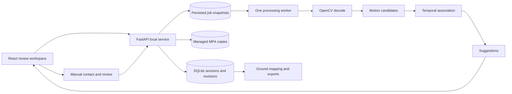

# Implementation architecture

## Decisions for increment 0.1

The goal is a useful manual analysis loop that can accept better tracking later. The app uses React + TypeScript, FastAPI, OpenCV, and SQLite. It runs as one local web service with a separate background thread for offline processing. A distributed queue and microservices would add complexity without helping a single-workstation prototype.

## Geometry contract

Image points are normalised to [0,1] in each axis, independent of preview image size. Ground x is metres left/right from the rectangle centre when facing the batter. Ground y is metres from the far/batter edge toward the bowler. The four reference corners map to `(-width/2,0)`, `(width/2,0)`, `(width/2,length)`, and `(-width/2,length)`.

Only bounce/contact locations are mapped into the ground plane. Airborne tracks remain image coordinates. A four-point transform fits the supplied corners exactly; its residual is not an independent accuracy measurement. This increment checks convexity/conditioning but leaves physical validation to measured check points and future tooling.

## Persistence contract

`sessions` contains the current state and revision. `revisions` stores every saved state immutably. Saves use an immediate SQLite transaction and the expected current revision; stale writes return HTTP 409. Restoring history loads a draft, and saving creates a new revision rather than deleting later history.

Each tracking job saves its input delivery, source SHA-256, calibration ROI, seed, input revision, and pipeline version. Results live on the job, separate from session state. The user can merge suggestions into a draft while retaining manual points. A later model can use the same result interface without rewriting the review workflow.

`data/media/` contains UUID-named imported copies. Clients never provide filesystem paths. Session deletion removes only app-owned copies and is blocked while a job is active. No automatic training-data collection occurs.

## Job lifecycle

Queued -> running -> completed/failed. The persisted job is created before work is submitted. A single worker bounds concurrent CPU use. An existing active job for the same delivery is reused. Process restart marks unfinished jobs as failed so the user can retry. Original predictions and manual corrections remain separate.

This is restart recovery, not distributed scheduling. Cancellation, heartbeat-based worker leases, global deduplication, and GPU scheduling are deferred. A queued/running job finishes before a graceful shutdown exits.

## Analysis contract

Statistics include reviewed contacts and explicitly labelled automatic estimates with eligible ground mappings. Their counts remain separate. Camera-ineligible contacts remain image-space locations and are excluded from metric statistics. Other unresolved results are also excluded. Standard deviations are population standard deviations; one point has zero spread and does not establish consistency. Filters affect displayed metrics/map/overlays; exports contain the whole saved session.

## Performance and future extension

Frame requests decode from a fresh capture and seek by nominal frame index. This is simple and works for manual review but may be slow for long-GOP/4K recordings. Thumbnail/frame caches and timestamp-aware decoding should be added after profiling. Playback is a sampled preview, not a high-FPS player.

The detector is replaceable. It can automatically seed from an isolated moving red component or use a manual saturated-colour seed. An HSV appearance model and local motion prediction select compatible centres; ambiguity and long gaps stop the track. Scores are heuristics, not probabilities.

`contact-analysis-0.3.0` attempts background-flow similarity compensation, then compares smooth quadratic motion against a continuous fit with a velocity discontinuity. Smooth trajectory apexes are rejected. A supported kink is a contact candidate, not a verified bounce. The approximate ball radius converts centre coordinates into a bottom/contact pixel. Fixed-camera calibration maps eligible contacts to ground coordinates; detected camera motion blocks this mapping. Line/length categories use provisional distance zones (under 2 m yorker, under 4 m full, under 7 m good length, otherwise short).

One-click analysis loads a new draft only if its input revision still matches and no intervening draft edits exist. Manual track points, manual bounces, and full-toss decisions are preserved. New contacts use `estimated`, never `reviewed`. Raw predictions remain immutable on the processing job.

## Evidence

The design uses [OpenCV projective geometry](https://docs.opencv.org/4.13.0/d9/d0c/group__calib3d.html) and [FastAPI uploads](https://fastapi.tiangolo.com/tutorial/request-files/). Stack choices and architecture are project decisions. The original SRS contains the technology investigation and source list.
